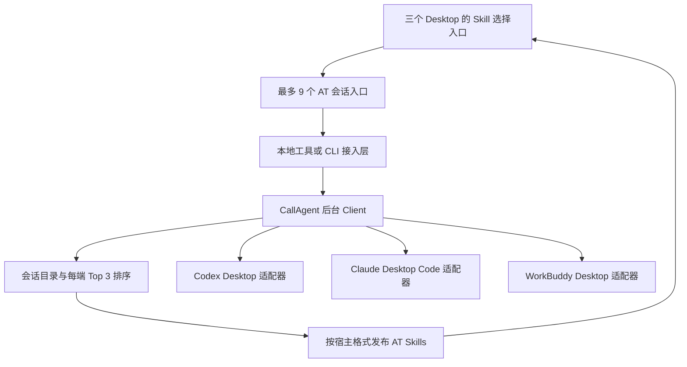

# 本机桌面会话与动态 AT 入口

记录日期：2026-11-22。本文落实项目所有者指定的后台 Client、三个桌面端和九个 AT 入口方案。本文保留需求与源码核对依据。2026-11-23 已落地本机运行时、三端适配器和动态 Skill 文件发布；具体命令、测试与尚未验收的菜单行为见 [运行时文档](runtime.md)。

## 用户交互

用户在 Codex Desktop、Claude 桌面端的 Code 会话或 WorkBuddy Desktop 中，通过宿主的 Skill 选择入口选择目标会话。期望在 `/` 菜单中看到以下格式：

```text
AT codex 手机端小小优化
AT Claude code 登录流程调整
AT WorkBuddy 整理项目文档
```

- 第一部分固定为 `AT`。
- 第二部分固定标识目标 Agent：`codex`、`Claude code`、`WorkBuddy`。
- 第三部分来自目标 session 名称，超过 10 个字截断。
- 每种 Agent 单独选取最活跃的 3 个 session，共最多 9 个；不足 3 个时显示实际数量，不拿其他 Agent 的会话补齐。
- 每个宿主发布同一份逻辑目标列表；来源桌面端不改变候选配额。
- 选择 AT 的默认行为是引用目标上下文；只有用户明确要求向目标发送消息时才投递。

`/` 菜单是产品交互目标，不是由 CallAgent 自己绘制的 GUI。宿主是否能在已有会话中显示所有动态条目、采用哪个名称字段、何时更新列表，需要逐端验收。不把“文件已写入”算成“菜单已更新”。

## 后台 Client 的职责



后台 Client 统一维护目录、状态与连接，按需读取目标详情。菜单生成只需要元信息，不持续载入所有会话全文。CLI 或 MCP 是桌面 Agent 调用 Client 的入口；Client 与目标 Desktop 的原生 IPC 是另一侧的连接，不能互相替代。

若采用 stdio MCP，每个宿主启动的只是接入进程，转发给同一个后台 Client，不各自启动一套发现、排序与 Skill 写入服务。工具集合可固定为目录、读取、发送、等待四类能力，不为九个 session 分别创建九套 MCP 工具。本文不将这些能力名当作已存在的命令。

## 排序、显示与绑定

以下为当前实现采用的默认值，用户调整时应同步更新：

- “最活跃”先按最后一次真实对话活动时间降序解释。来源只能提供 `updatedAt` 时使用该值并保留来源说明；不同端时间统一到毫秒。读取详情、扫描目录、生成 Skill、客户端心跳不更新会话活动时间。
- 同一 Agent 内时间相同时按原生 ID 稳定排序；不因扫描顺序变化反复更换条目。
- 标题按用户可见字符截取前 10 个，不能按 UTF-8 字节截断；组合字符和 emoji 不应切碎。默认不额外增加省略号。空标题使用“未命名会话”。
- 截断只影响展示。完整标题、Agent、账号/配置实例、原生 session ID 和项目上下文仍保留在绑定记录中。
- 身份键至少包含 `provider + profile + nativeSessionId`，发布目录使用稳定且适合文件名的标识；标题和第几名都不参与路由。
- 每条生成的 Skill 内容携带明确的目标身份。旧 Skill 已加载后，即使该 session 掉出 Top 3，也不能改为指向新的第 3 名；标题变化只更新显示。
- 不创建九个完全同名为 `AT` 的技能来依赖列表顺序区分。`AT` 是固定前缀，每条仍有独立身份。相同截断标题使用描述中的完整标题、项目与短 ID 辅助区分，不改变绑定。
- 正常刷新成功后发布新 Top 3；某端暂时失败时保留最后一次成功目录并标记过期，读取时重新验证。没有可靠目录时不生成虚构会话。

## 原生接入参考：ObeingWorkspace

用户给定位置中实际存在的项目为 `~/projects/Obeing/ObeingAgent/ObeingWorkspace`。本次只读核对该仓库，版本为 `f7ea7672a215bd3b785d41ef3f7bfd1bc5d7596e`，没有修改它，也没有读取用户会话正文或连接运行中的桌面应用。

下表路径均相对参考项目根目录。源码所用内部协议不等同于产品的公开稳定 API，迁移后须验证目标桌面版本。

| 目标 | 会话目录 | 详情与已有桌面会话连接 | 重点参考 |
| --- | --- | --- | --- |
| Codex Desktop | `HistoryRuntime.cpp::ListCodexThreads` 经只读 app-server `thread/list`，按 `updated_at` 分页 | `thread/read`、`thread/turns/list` 读取历史；桌面 follower IPC 查找 owner，订阅状态与补全历史，向该 owner 投递 | `backend/ObeingClient/src/agent/HistoryRuntime.cpp`、`backend/ObeingClient/src/agent/acp/DesktopIpc.cpp`、`backend/ObeingClient/src/agent/acp/DesktopBridge.cpp`、`backend/ObeingClient/AgentCore/src/history/CodexHistory.cpp` |
| Claude Desktop Code | `DesktopSession::List` 查注册记录、进程身份和桌面插件心跳 | `Snapshot` 只读 transcript；发送通过 peer IPC 和已加载的桥接插件调用同一个 Desktop 引擎 | `backend/ObeingClient/src/agent/claude/DesktopSession.cpp`、`backend/ObeingClient/resources/claude-desktop/hooks/register.js`、`backend/ObeingClient/CLAUDE_DESKTOP_SETUP.md` |
| WorkBuddy Desktop | `HistoryRepository::List` 只读 SQLite，筛选当前账号、local、未删除记录 | 已鉴权的 Local RPC 读取 `wb:conversations:requests` 等通道；历史也有 JSONL 只读路径；发送走 `edge-sync/invokeSendPrompt` | `backend/ObeingClient/src/persistence/WorkBuddyHistoryRepository.cpp`、`backend/ObeingClient/src/agent/acp/WorkBuddyLocalRpc.cpp`、`backend/ObeingClient/src/agent/acp/WorkBuddyBridge.cpp` |

源码证明可借鉴现成实现，但不是“统一一个 IPC 调用就获得三端全部目录与详情”。目录发现、历史读取和活动桌面会话投递要分别封装，普通 CLI 会话不能混入 Desktop 的可投递目标。

### Codex

参考实现用 Windows named pipe 或 Unix domain socket 连接 Desktop；帧采用小端长度前缀加 JSON。初始化后对具体 `conversationId` 进行 owner discovery，按目标 owner 订阅状态，校验版本、快照和增量。`thread/list` 目录来自 app-server，并不是这个 follower socket 直接提供的会话目录接口。

需要进一步验证目录候选与 Desktop 管理的会话集合之间的关系，不能因本机存在一条 CLI 历史就认为桌面能接收投递。参考实现在桌面 owner 不存在时有普通运行时回退路径；CallAgent 的 Desktop 目标不能照搬该回退来另起 CLI 执行。

### Claude Desktop Code

参考实现识别 `claude-desktop` / `claude-desktop-3p` 注册项、存活进程及 `local_` host session，并依赖单独的桥接插件、有效租约和心跳。消息详情来自只读 transcript，不是纯 IPC 返回全部历史。发送经过 `session.receive`，最终执行 `prompt.submit({asUser: true})`。

参考文档记录了 Windows 真实 Desktop 文本往返和重新打开会话后的验证；macOS 执行能力仍标为待真机验收。不能因源码包含 Unix socket 分支就宣布 macOS 三端互通完成。插件安装在磁盘上也不等于已经加载，已有会话可能需要宿主自己的刷新流程。

### WorkBuddy

参考实现先通过本机调试入口领取 Local RPC 描述和短期票据，关闭调试 WebSocket 后连接 `workbuddy.local-rpc.v2`，验证 challenge/proof，再调用获准方法。它不是无鉴权的普通 WebSocket。

源码还提供 `CommandSources`：通过 `config:getProductConfiguration` 获取 Skill 扫描目录配置，再调用 `skill:list` 和 `plugin:getInstalledCommands` 查询命令目录。这可用于验证 AT 条目是否真的被宿主发现，但不能据此假定 `/` 菜单已热刷新。

参考项目记录了桌面 Local RPC 的连接数限制，不能为九个菜单条目常驻九条活动连接。应由后台 Client 统一管理、按需读取和连接，不把排序列表长度当成连接池大小。参考项目的桌面重启/调试端口守护也不应直接作为菜单刷新手段迁入。

WorkBuddy 的 macOS 自动发现与守护接管已迁入 CallAgent：参考 `WorkBuddyDiscovery.cpp` 和 `WorkBuddySupervisor.cpp`，复用正常入口，缺少端口的已有实例带端口重启一次。CallAgent 不采用强制结束进程；拒绝退出、入口未就绪和归属不明时等待。开关、状态及验证范围见 [运行时文档](runtime.md)。

## Skill 发布与宿主兼容

- 将 `skills/callagent-session/SKILL.md` 作为公共操作规则来源；九条入口是绑定具体 session 的生成结果，不是在它里面列出九个固定标题。
- 各宿主的技能目录、名称字段和显示元数据由发布适配器处理。`AT + Agent + 短标题` 是展示要求，稳定内部键与具体显示字段分开维护；任何内部名字都不能靠解析展示标题还原目标。
- 发布时只管理自身生成的目录；保留用户其他 Skills。以完整快照更新，成功后清理退出榜单的自有条目，失败时保留上一版。
- 已被宿主加载的旧入口仍绑定原始 session；执行时检查目标和当前能力，不自动重定向。
- 公共规则文件不额外作为第十条 AT 入口安装。共享扫描目录去重，避免一个宿主从多个目录发现同一条 AT。
- 不在 `SKILL.md` 中写参考项目、IPC 调研或开发计划；入口只包含操作规则、目标绑定和已经实现的工具用法。

官方机制核对（2026-11-22）：

- Codex 的 Skills 文档描述了 Skill 目录和变更检测，并提供 `agents/openai.yaml` 的 `display_name` 元数据；文档也提示更新未生效时重启。它不能单独证明当前 Desktop `/` 菜单的显示字段、排序和零延迟更新。
- Claude Code 的 Skills 文档提供名称、调用可见性和加载机制配置。CLI 文档与目标 Desktop Code 界面的具体菜单显示和刷新行为仍需分别核实。
- WorkBuddy Connector 文档确认支持 `SKILL.md` 与 CLI 或 MCP 组合分发；CodeBuddy IDE Skills 文档只能作为目录结构参考，不能直接当作 WorkBuddy Desktop 的安装路径约定。尚未找到能承诺生成文件后所有已打开会话的 `/` 列表立即刷新的契约。

来源：

- <https://developers.openai.com/codex/skills>
- <https://code.claude.com/docs/en/skills>
- <https://www.codebuddy.ai/docs/ide/Features/Skills>
- <https://open.workbuddy.cn/docs/connector>

## 实现顺序与验收

1. 将三个原生适配器中的目录和有界详情读取独立到 C++20 本机 Client，保留已验证的身份和能力，先形成可检查的会话列表。
2. 实现每端 Top 3、10 字标题、稳定绑定和独立于读取操作的活动排序。
3. 实现各宿主的 AT Skill 发布与调用入口，逐端验证已有会话中新增、改名、退出榜单和重新打开菜单的行为。
4. 接通 AT → 本地工具/CLI → 后台 Client → 指定原生 session 的上下文读取闭环；再接入用户明确授权的发送和回执关联。
5. 在三种 Desktop 上验证各显示最多九条、未满额、不在线、同名标题、中文/emoji、排名变化后的旧入口，以及跨 Agent 读取/发送行为。

参考项目部分桥接依赖 C++23；CallAgent 继续使用 C++20/CMake/libhv，按功能边界借鉴协议和实现，不直接引入整个桥接进程、云端 Relay、Web UI 或更高语言标准。
