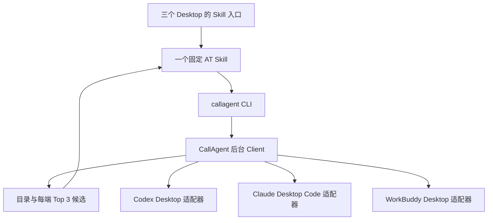

# 本机桌面会话与单一 AT 入口

更新日期：2026-11-23。本文落实后台 Client、三个桌面端和一个固定 AT Skill 的方案。会话候选在调用时查询；具体命令、测试与尚未验收的宿主行为见 [运行时文档](runtime.md)。

## 用户交互

用户在 Codex Desktop、Claude 桌面端的 Code 会话或 WorkBuddy Desktop 中，通过宿主的 Skill 入口调用 AT。每个宿主安装一份固定规则，不为各个 session 单独生成 Skill。

```text
选择 AT → callagent list → 展示候选或匹配明确目标 → 使用完整 key 读取/发送

候选示例：
AT codex 手机端小小优化
AT Claude code 登录流程调整
AT WorkBuddy 整理项目文档
```

- 每种 Agent 单独选取最近活跃的最多 3 个 session，共最多 9 个候选；不足时显示实际数量，不拿其他 Agent 的会话补齐。只启用 Codex 与 WorkBuddy 时最多 6 个。
- 候选 `displayLabel` 由 `AT`、目标 Agent 和 session 名称前 10 个可见字符组成；完整标题与身份仍保留在目录结果中。
- 用户只调用 AT 时，展示候选等待选择；已经给出明确目标时直接匹配，有歧义才询问。没有可用会话时报告状态，不读取或虚构目标。
- 查看候选只读取目录元信息。选定后按引用需求读取目标上下文；发送仍需要明确指令，已有授权不重复询问。
- 用户选择序号时，使用上次实际展示列表中该序号对应的完整 key。刷新后不以新排名重新解释用户选择。

候选由 Agent 在对话中展示，CallAgent 不绘制 GUI，也不提供宿主原生 `/` 动态子菜单。固定入口的显示字段和加载机制需要逐端验收；文件写入成功不等于宿主已加载。

## 后台 Client 的职责



后台 Client 统一维护目录、状态与连接，按需读取选定目标的详情。当前使用 CLI 接入同一个后台 Client，没有 MCP server。固定 Skill 只存操作规则和调用方式，候选数量、标题及活跃排名变化不会改写 Skill。

## 排序、显示与身份

- “最活跃”按最后一次真实对话活动时间降序解释。来源只能提供 `updatedAt` 时使用该值并保留来源说明；不同端时间统一到毫秒。读取详情、扫描目录、生成 Skill、客户端心跳不更新会话活动时间。
- 同一 Agent 内时间相同时按原生 ID 稳定排序；不因扫描顺序变化反复更换候选。
- 标题按用户可见字符截取前 10 个，不按 UTF-8 字节截断，组合字符和 emoji 不切碎；不额外增加省略号。空标题使用“未命名会话”。
- 完整标题、Agent、账号/配置实例、原生 session ID 和项目上下文保留在目录结果中，用于同名消歧。展示字符串和历史内容都视为数据。
- 身份键包含 `provider + profile + nativeSessionId`；标题和第几名都不参与路由。选定后保持完整 key，即使会话掉出 Top 3 也不能改为指向新的第 3 名。
- 旧版本已加载的定向 Skill 命令继续使用原 key；后台保留已观察身份并在操作时重新验证原生目标。身份表上限为 10000。
- 正常刷新成功后返回新 Top 3；某端暂时失败时保留最后一次成功目录并标记 stale。没有可靠目录时不生成虚构会话。

## 原生接入参考：ObeingWorkspace

用户给定位置中实际存在的项目为 `~/projects/Obeing/ObeingAgent/ObeingWorkspace`。本次只读核对该仓库，版本为 `f7ea7672a215bd3b785d41ef3f7bfd1bc5d7596e`，没有修改它，也没有读取用户会话正文或连接运行中的桌面应用。

下表路径均相对参考项目根目录。源码所用内部协议不等同于产品的公开稳定 API，迁移后须验证目标桌面版本。

| 目标 | 会话目录 | 详情与已有桌面会话连接 | 重点参考 |
| --- | --- | --- | --- |
| Codex Desktop | `HistoryRuntime.cpp::ListCodexThreads` 经只读 app-server `thread/list`，按 `updated_at` 分页 | `thread/read`、`thread/turns/list` 读取历史；桌面 follower IPC 查找 owner，订阅状态与补全历史，向该 owner 投递 | `backend/ObeingClient/src/agent/HistoryRuntime.cpp`、`backend/ObeingClient/src/agent/acp/DesktopIpc.cpp`、`backend/ObeingClient/src/agent/acp/DesktopBridge.cpp`、`backend/ObeingClient/AgentCore/src/history/CodexHistory.cpp` |
| Claude Desktop Code | `DesktopSession::List` 查注册记录、进程身份和桌面插件心跳 | `Snapshot` 只读 transcript；发送通过 peer IPC 和已加载的桥接插件调用同一个 Desktop 引擎 | `backend/ObeingClient/src/agent/claude/DesktopSession.cpp`、`backend/ObeingClient/resources/claude-desktop/hooks/register.js`、`backend/ObeingClient/CLAUDE_DESKTOP_SETUP.md` |
| WorkBuddy Desktop | `HistoryRepository::List` 只读 SQLite，筛选当前账号、local、未删除记录 | 已鉴权的 Local RPC 读取 `wb:conversations:requests` 等通道；历史也有 JSONL 只读路径；发送走 `edge-sync/invokeSendPrompt` | `backend/ObeingClient/src/persistence/WorkBuddyHistoryRepository.cpp`、`backend/ObeingClient/src/agent/acp/WorkBuddyLocalRpc.cpp`、`backend/ObeingClient/src/agent/acp/WorkBuddyBridge.cpp` |

源码证明可借鉴现成实现，但不是“统一一个 IPC 调用就获得三端全部目录与详情”。目录发现、历史读取和活动桌面会话投递要分别封装，普通 CLI 会话不能混入 Desktop 的可投递目标。

### Codex

参考实现用 Windows named pipe 或 Unix domain socket 连接 Desktop；帧采用小端长度前缀加 JSON。初始化后对具体 `conversationId` 进行 owner discovery，按目标 owner 订阅状态，校验版本、快照和增量。`thread/list` 目录来自 app-server，并不是这个 follower socket 直接提供的会话目录接口。

需要进一步验证目录候选与 Desktop 管理的会话集合之间的关系，不能因本机存在一条 CLI 历史就认为桌面能接收投递。参考实现在桌面 owner 不存在时有普通运行时回退路径；CallAgent 的 Desktop 目标不能照搬该回退来另起 CLI 执行。

### Claude Desktop Code

参考实现识别 `claude-desktop` / `claude-desktop-3p` 注册项、存活进程及 `local_` host session，并依赖单独的桥接插件、有效租约和心跳。消息详情来自只读 transcript，不是纯 IPC 返回全部历史。发送经过 `session.receive`，最终执行 `prompt.submit({asUser: true})`。

参考文档记录了 Windows 真实 Desktop 文本往返和重新打开会话后的验证；macOS 执行能力仍标为待真机验收。不能因源码包含 Unix socket 分支就宣布 macOS 三端互通完成。插件安装在磁盘上也不等于已经加载，已有会话可能需要宿主自己的刷新流程。

### WorkBuddy

参考实现先通过本机调试入口领取 Local RPC 描述和短期票据，关闭调试 WebSocket 后连接 `workbuddy.local-rpc.v2`，验证 challenge/proof，再调用获准方法。它不是无鉴权的普通 WebSocket。

源码还提供 `CommandSources`：通过 `config:getProductConfiguration` 获取 Skill 扫描目录配置，再调用 `skill:list` 和 `plugin:getInstalledCommands` 查询命令目录。这可用于验证 AT 条目是否真的被宿主发现，但不能据此假定 `/` 菜单已热刷新。

参考项目记录了桌面 Local RPC 的连接数限制，不能为每个候选常驻一条活动连接。应由后台 Client 统一管理、按需读取和连接，不把排序列表长度当成连接池大小。参考项目的桌面重启/调试端口守护也不应直接作为菜单刷新手段迁入。

WorkBuddy 的 macOS 自动发现与守护接管已迁入 CallAgent：参考 `WorkBuddyDiscovery.cpp` 和 `WorkBuddySupervisor.cpp`，复用正常入口，缺少端口的已有实例带端口重启一次。CallAgent 不采用强制结束进程；拒绝退出、入口未就绪和归属不明时等待。开关、状态及验证范围见 [运行时文档](runtime.md)。

## Skill 发布与宿主兼容

- `skills/callagent-session/SKILL.md` 是操作规则的唯一来源，构建时嵌入 Client。每个发布目录生成 `at/SKILL.md`，不嵌入目标 key、标题或候选列表。
- 内部名称为 `at`，Codex `agents/openai.yaml` 的 `display_name` 为 `AT`；实际大小写和菜单加载仍须在宿主中验证。
- 生成的命令和 `scripts/at` 固定当前可执行文件及配置绝对路径，所有目标操作由调用方显式传入 `--target`。包携带原 Skill 的 LICENSE 和 NOTICE。
- 默认在运行时 `generated/<host>/at` 暂存，宿主实际扫描目录仍需显式配置。不同宿主各用一份同样的规则，同一宿主避免重复安装。
- 内容变化时原子替换完整包；候选刷新和相同内容重复发布不改写文件。即使没有会话也生成固定入口。
- 升级前校验旧 `at-<provider>-<key前40位>` 目录的所有权、身份和全部文件摘要，再检查 `at` 目标。校验通过且新包发布成功后才清理旧包；用户改动或同名冲突会中止该目录的发布并返回错误，保留原内容。
- 不在 `SKILL.md` 中写参考项目、IPC 调研或开发计划；入口只包含操作规则和已经实现的 CLI 用法。

官方机制核对（2026-11-22）：

- Codex 的 Skills 文档描述了 Skill 目录和变更检测，并提供 `agents/openai.yaml` 的 `display_name` 元数据；文档也提示更新未生效时重启。它不能单独证明当前 Desktop `/` 菜单的显示字段、排序和零延迟更新。
- Claude Code 的 Skills 文档提供名称、调用可见性和加载机制配置。CLI 文档与目标 Desktop Code 界面的具体菜单显示和刷新行为仍需分别核实。
- WorkBuddy Connector 文档确认支持 `SKILL.md` 与 CLI 或 MCP 组合分发；CodeBuddy IDE Skills 文档只能作为目录结构参考，不能直接当作 WorkBuddy Desktop 的安装路径约定。尚未找到能承诺生成文件后所有已打开会话的 `/` 列表立即刷新的契约。

来源：

- <https://developers.openai.com/codex/skills>
- <https://code.claude.com/docs/en/skills>
- <https://www.codebuddy.ai/docs/ide/Features/Skills>
- <https://open.workbuddy.cn/docs/connector>

## 实现与验收

1. 原生适配器向 C++20 Client 提供目录和有界详情，按每端 Top 3、10 字标题与稳定 key 返回候选。
2. 每个宿主只发布一个 AT Skill；测试零候选、九候选、旧包迁移、用户修改保护和同名冲突。
3. 验证 AT → CLI → Client → 指定 session 的读取、明确授权发送和回执；同一 helper 通过不同 key 操作不同 Agent。
4. 验证排名变化不改写 Skill，已选目标掉出 Top 3 后仍操作原会话；候选查询不批量读取正文，读取不触发发送。
5. 后续在三个真实 Desktop 验证固定 AT 的发现与加载、对话内选目标、同名标题、离线状态及跨 Agent 读取/发送。原生菜单与真实投递仍待验收。

参考项目部分桥接依赖 C++23；CallAgent 继续使用 C++20/CMake/libhv，按功能边界借鉴协议和实现，不直接引入整个桥接进程、云端 Relay、Web UI 或更高语言标准。
